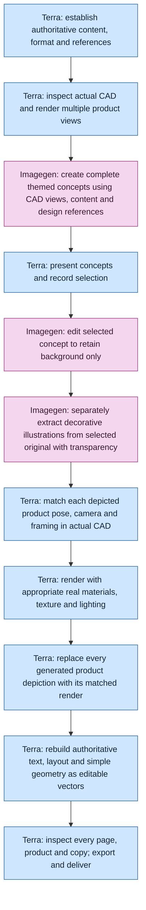

# Product document workflow

This diagram is the canonical sequence. Terra owns evidence, CAD rendering, production layout, and verification. Imagegen owns visual concept generation and raster edits. Selection may already be supplied by the user; a request to finish a particular concept is sufficient.

Backgrounds, paintings and textures normally remain raster. Simple geometry is editable vector artwork. Suitable illustrations or backgrounds may be vectorized on request where fidelity permits. Preserve the original concept, background, transparent decorations, CAD renders, editable source, and export as separate assets. Track revision, selection, prompts and provenance; do not label generated hardware as a CAD render.
